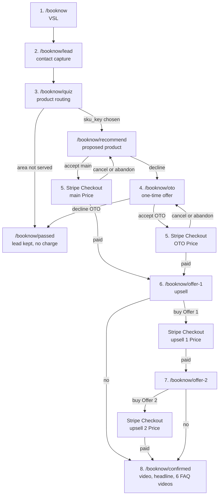

# Book Now funnel architecture

**Status:** architecture only. This document does not add pages, routes, Stripe calls, or checkout behavior. A later build implements it.

**Site:** Rivanna Home Cleaning, Charlottesville, VA. Live domain `https://rivannahomecleaning.com`. Static HTML, CSS, and JS, with a Cloudflare Worker in front (`worker/index.js`, `wrangler.jsonc`). Clean URLs already exist: `contact.html` is the public page `/contact`. `/booknow` should follow that pattern when it is built.

**Owner brief:** a ClickFunnels-style sales path. Video, then a contact lead, then a quiz that picks a Stripe product, then a one-time offer if they decline that product, then Stripe Checkout, then two post-purchase offers, then a confirmation page whose FAQs are videos.

**Customer-facing copy rules for every later page:** no em dashes. Say insured. Never say bonded. Phone `(434) 205-6384`. Email `book@rivannahomecleaning.com`. Hours Monday–Friday, 8am–8pm. Voice: warm, neighborly, local. The locked design system (`design-system.md`) still says the insured claim was removed on 2026-10-04 until coverage is active, and it also says prices are never published. Both rules conflict with this funnel. See [Open questions](#10-open-questions-and-assumptions). Do not print "insured" or a dollar amount on a public page until Joel resolves those two items.

---

## What exists today (constraints)

| Piece | Where it lives | What the funnel should do with it |
| --- | --- | --- |
| Clean URLs | `contact.html` canonical `/contact`. Worker assets directory is the repo root. | Add HTML files under `booknow/` so `/booknow` and `/booknow/lead` work the same way. No build step. |
| Worker API | `wrangler.jsonc` sets `run_worker_first` for `/api/*`. `worker/index.js` handles `POST /api/survey` and returns 404 for every other `/api/*` path. Unknown paths fall through to static assets. | Later, add `/api/booknow/*` on this same Worker. The browser never holds a Stripe secret. |
| Contact capture | `contact.html` embeds a GoHighLevel form iframe: `https://grow.scaleful.io/widget/form/IdPxo8Zh3QPQ02mTz8Dy` plus `https://grow.scaleful.io/js/form_embed.js`. Height is fixed around 1131px. | Leave `/contact` as it is. The funnel needs branching the iframe cannot do cleanly. |
| Survey pattern | `survey.html` is a native HTML form. It posts JSON to `/api/survey`. A honeypot field named `website` is dropped. The Worker forwards to a GHL inbound webhook (`GHL_SURVEY_WEBHOOK_URL`). | This is the pattern to copy for funnel forms. |
| Chat widget | LeadConnector loader, widget id `6ab3231e08a179ce38105cd3`, on marketing pages. | Optional on funnel pages. It is not a step in the flow. |
| Quick Book calendar | `https://api.leadconnectorhq.com/widget/booking/k2QR6BUxxsdIHPbV6qOt` | Optional link on the confirmation page and the no-purchase exit. It is not the front door. |
| Payments today | Terms say payment is due at the time of service. Historically customers pay after the job by Stripe Payment Link or Zelle. Public prices and online prepay are new. | Payment Links and Zelle stay available for jobs booked the old way. This funnel uses Stripe Products and Prices through Checkout Sessions. |
| Analytics already on the site | gtag `G-4K0GCV1JKV`. Meta Pixel `1357863269567859` with `PageView`, plus `Contact` on `tel:` clicks. | Reuse these IDs. Do not invent a second pixel or GA4 property. |
| Design system | `design-system.md` and `assets/css/styles.css`. Bitter headlines, Public Sans body, teal `#184D59`, existing `.field`, `.btn-primary`, `.page-hero`. | Funnel pages reuse the stylesheet. No new palette. |
| Primary nav | Home, Services, Service Areas, About, Reviews, Contact. CTA is "Get a Quote" to `/contact#quote`. | Do not replace the nav with `/booknow` in the first build. A later, separate change can add an optional link after Joel says the funnel is public. |
| Legal | `terms-of-service.html` (pay at time of service; quotes are estimates). `privacy-policy.html` names Meta and GoHighLevel. It does not name Stripe. | Update both in the implementation phase, after a Virginia attorney reviews them, before real charges. |

---

## 1. High-level flow

Joel’s order, with the exits this document assumes. Assumptions are marked `A-` and collected again in section 10.



ClickFunnels-style defaults used here (labeled so a later build can change them):

| Id | Default this architecture adopts |
| --- | --- |
| CF-1 | Steps are linear. A later URL does not unlock itself. The Worker checks the session before it renders an offer or starts Checkout. |
| CF-2 | The OTO is a substitute for the proposed product. Accepting it charges the OTO Price only. It does not stack on top of the main product. |
| CF-3 | The OTO is shown once per funnel session. Declining it records a no and leaves Stripe closed. |
| CF-4 | There is no downsell after the OTO. Main declined and OTO declined ends at `/booknow/passed`. |
| CF-5 | Offer 2 appears only after Offer 1 is accepted and paid. "No" on Offer 1 skips Offer 2 and opens confirmation. |
| CF-6 | "No" on Offer 2 opens confirmation. Offer 1, if paid, stays paid. |
| CF-7 | There is no order bump on the Checkout page in v1. |
| CF-8 | A refresh does not create a second charge for the same SKU on the same session. |
| CF-9 | Classic ClickFunnels one-click upsells vault the card. v1 uses a new hosted Checkout for each accept (main, OTO, Offer 1, Offer 2). One-click is a later option, described in section 4. |

`A-OTO-UPSELL`: after a paid OTO, Offer 1 and Offer 2 still appear. Joel may instead want OTO buyers to skip upsells. Until he says so, the chain stays the same for both paid paths.

---

## 2. Route and page map

Public URLs have no `.html` and no trailing slash, matching `/contact`. Files, when built, would be:

| File (future) | Public URL |
| --- | --- |
| `booknow/index.html` | `/booknow` |
| `booknow/lead.html` | `/booknow/lead` |
| `booknow/quiz.html` | `/booknow/quiz` |
| `booknow/recommend.html` | `/booknow/recommend` |
| `booknow/oto.html` | `/booknow/oto` |
| `booknow/offer-1.html` | `/booknow/offer-1` |
| `booknow/offer-2.html` | `/booknow/offer-2` |
| `booknow/confirmed.html` | `/booknow/confirmed` |
| `booknow/passed.html` | `/booknow/passed` |
| `booknow/processing.html` | `/booknow/processing` |

All of these are `noindex` until Joel marks the funnel public. They are not in the primary nav.

Stripe’s hosted Checkout page is not a file in this repo. The Worker creates a Checkout Session and the browser goes to the `url` Stripe returns.

| Step | URL | What renders | Continue | Other exit |
| --- | --- | --- | --- | --- |
| 1. VSL | `/booknow` | Logo, phone, one video embed (`CONFIG.media.vsl`), short headline, one button. | Button goes to `/booknow/lead`. | Direct visit is always allowed. |
| 2. Lead | `/booknow/lead` | Native contact form. | Valid submit creates the server session and opens `/booknow/quiz`. | Validation errors stay on the page. |
| 3. Quiz | `/booknow/quiz` | Product-routing questions. | In-area result stores `sku_key` and opens `/booknow/recommend`. | Out of area opens `/booknow/passed?reason=area`. Missing Price for that key opens `/booknow/passed?reason=unpriced` and does not call Stripe. |
| Proposed product | `/booknow/recommend` | The SKU the quiz chose: placeholder name, the amount Stripe has on that Price (read from config, never typed by the browser into the charge), accept and decline. | Accept calls `POST /api/booknow/checkout` with `sku_role=main` and redirects to Stripe. | Decline opens `/booknow/oto`. |
| 4. OTO | `/booknow/oto` | One alternate offer. | Accept calls checkout with `sku_role=oto` and redirects to Stripe. | Decline opens `/booknow/passed?reason=declined`. |
| 5. Checkout | Stripe hosted page | Card, Link, receipt email. | `success_url` is `/booknow/offer-1?session_id={CHECKOUT_SESSION_ID}` for both main and OTO. | `cancel_url` returns to `/booknow/recommend` or `/booknow/oto`, matching the role that was being bought. |
| 6. Offer 1 | `/booknow/offer-1` | Upsell. Shown only when the Worker has confirmed the main or OTO Checkout is paid (or processing; see delayed payment). | Accept starts Checkout for `sku_role=upsell_1`. Success URL is `/booknow/offer-2?session_id={CHECKOUT_SESSION_ID}`. | Decline sets the flag and opens `/booknow/confirmed`. |
| 7. Offer 2 | `/booknow/offer-2` | Second upsell. Shown only when Offer 1 is paid on this session. | Accept starts Checkout for `sku_role=upsell_2`. Success URL is `/booknow/confirmed?session_id={CHECKOUT_SESSION_ID}`. | Decline opens `/booknow/confirmed`. |
| 8. Confirmation | `/booknow/confirmed` | Headline, confirmation video, six FAQ video embeds. Copy differs for a paid session vs. a direct visit with no paid session (see edge cases). | End of funnel. Optional calendar link below the videos. | A direct visit with no paid session does not say the job is booked. |
| No purchase | `/booknow/passed` | Warm exit. Lead is already saved. Phone, email, hours. | Optional calendar link. No Stripe button on this page. | Someone who already paid is sent to the next unpaid offer, or to confirmation if the offer chain is done. |
| Delayed payment | `/booknow/processing` | Short "your bank is still confirming this payment" page. | When status becomes `paid`, the same success hop as Checkout (Offer 1, Offer 2, or confirmation). | `async_payment_failed` returns them to the decision page they were buying, with a plain-language retry line. |

Header on funnel pages: logo (links home), phone link, email. Full marketing nav stays off these URLs so the path reads as one sequence. The rest of the site keeps its current nav.

### Edge cases

| Situation | Behavior |
| --- | --- |
| They buy Offer 1, then say no to Offer 2 | Confirmation. The original purchase and Offer 1 both stand. Offer 2 is not charged. Refreshing confirmation does not ask again. |
| They say no to Offer 1 | Confirmation immediately. Offer 2 is never shown. `A-CF-5`. |
| They say no to the proposed product and no to the OTO | `/booknow/passed`. No Checkout Session is created. The GHL contact remains, tagged `booknow_declined`. |
| They say no to the proposed product and yes to the OTO | Checkout charges the OTO Price only. On success they still see Offer 1 (`A-OTO-UPSELL`). |
| They accept, then close Stripe or click the Stripe back link | `cancel_url` returns to recommend or OTO. Status stays unpaid. Upsells stay locked. GHL tag `booknow_checkout_abandoned`. The accept button can start a new Session. |
| They abandon before Checkout (close the tab on the VSL, lead form, or quiz) | Cookie resume if they return on the same browser within 14 days. GHL already has the lead once the lead form succeeded, so the office can follow up by phone. No charge. |
| Checkout Session expires | Stripe’s hosted Session lasts 24 hours. Webhook `checkout.session.expired` sets status `checkout_expired` and tags GHL. The next accept creates a new Session. The idempotency key includes an attempt number so Stripe does not replay the dead Session. |
| They already exist in GHL | Upsert by phone, then by email. Do not create a second person. See "Lead already exists" below. |
| They already paid this SKU on this funnel session | The Worker refuses another Checkout for that `sku_role`. Send them forward: unpaid Offer 1, else unpaid Offer 2 if Offer 1 was paid, else confirmation. |
| Same email, new visit, cookie gone | Lead submit looks up the email index. If a paid funnel from the last `CONFIG.session.resume_days` (default 14) is still open on upsells, resume it. If that order is already confirmed, show confirmation with "we already have this request" and the phone number. Do not charge the main SKU again inside that window (`A-RESUME-WINDOW`). |
| Direct load of `/booknow/offer-1` or `/booknow/offer-2` without a paid gate | Redirect to `/booknow`. |
| Direct load of `/booknow/confirmed` with no paid session | Soft landing: the videos may still play, the headline does not claim a booking, and the buttons are "Start a booking" and the phone number. |
| Webhook arrives before the browser returns | Offer page reads KV, already `paid`, and renders. |
| Browser returns before the webhook | Offer page calls `GET /api/booknow/session`, which retrieves the Checkout Session from Stripe. Stripe is the payment authority. The webhook is the backup that advances state if the shopper never returns. |
| Card declined inside Stripe | They stay on Stripe’s page and can retry there. Our upsells stay locked. |
| Bank debit or other delayed method | Success URL opens `/booknow/processing` until `checkout.session.async_payment_succeeded`. Upsells wait. `A-DELAYED-PAY`: v1 can also disable delayed methods and accept cards only. Prefer that until Joel asks for ACH. Set `payment_method_types: ['card']` on the Session. |
| Double-click "Yes, book this" | One idempotency key per attempt. The second click receives the same Checkout URL. |
| Offer 1 charge fails after the main charge succeeded | They remain on Offer 1 with a short error and a "No thanks" path to confirmation. The main payment is not reversed here. |
| Two tabs | Server session wins. The tab that loads second follows the latest paid or declined flags. |
| Back button after a decline | Flags stick. OTO does not reappear after `oto=declined`. Recommend can still be accepted until they pass the exit page, so a changed mind does not require a new lead. After `/booknow/passed`, a text link "Show me that option again" clears only the decline flag, not the contact. |
| Quiz picks a `sku_key` whose Price id is still `price_REPLACE_ME` | Do not call Stripe. `/booknow/passed?reason=unpriced` plus a Worker log. The customer sees the phone number, not a stack trace. |
| Service area fails | Lead is saved. No product page, no Stripe. `/booknow/passed?reason=area`. |
| Shared computer | Confirmation shows first name and the service label only. It does not show full address or card data. Stripe never gives us the full card number. |
| Refund | Not a self-serve button in v1. Office uses the Stripe Dashboard. Policy text is an open question. |

---

## 3. Data model and state

Three stores, three jobs:

| Store | Job | Holds |
| --- | --- | --- |
| Stripe | Money ledger | Customer, Checkout Session, PaymentIntent, charge. |
| GoHighLevel | Person and follow-up | Contact, tags, notes. Office calls and texts happen here, as they do today. |
| Worker KV `BOOKNOW` | Funnel router | The session document below. TTL 30 days. |

The browser keeps an HttpOnly cookie that points at the KV record. It does not keep payment status.

```
Cookie: rhc_fnl=<funnel_id>
HttpOnly; Secure; SameSite=Lax; Path=/; Max-Age=14 days
```

`localStorage` may remember in-progress quiz answers so a refresh does not clear the form. Charge decisions ignore `localStorage`. Query parameters do not set the SKU or the price. The only payment query parameter we accept is Stripe’s `session_id` on the return URL, and the Worker reloads that Session with the secret key. It must match `client_reference_id === funnel_id` from the cookie (or from the email index when the cookie was dropped). A `sku` or `price` query parameter is ignored.

### Session document (KV key `fnl:<uuid>`)

```yaml
id: "uuid"
created_at: "ISO-8601"
updated_at: "ISO-8601"
status: >-
  lead | routed | checkout_open | checkout_expired |
  paid_primary | upsell_1_paid | confirmed | passed
contact:
  name: ""
  first_name: ""
  last_name: ""
  email: ""
  phone: ""
  zip: ""
  consent_sms: false
  consent_email: true
ghl:
  contact_id: ""          # filled when the webhook or API returns one
  upsert: "phone_then_email"
route:
  answers: {}             # raw quiz answers
  sku_key: ""             # server-side key, e.g. deep-cleaning
  area_ok: true
decisions:
  main: null              # accept | decline
  oto: null               # accept | decline
  upsell_1: null          # accept | decline
  upsell_2: null
stripe:
  customer_id: ""         # cus_...
  charges: []             # one entry per Checkout attempt
```

Each `charges[]` entry:

```yaml
role: "main"              # main | oto | upsell_1 | upsell_2
sku_key: ""
price_id: ""              # server copied this from config at charge time
checkout_session_id: ""   # cs_...
payment_intent_id: ""     # pi_...
status: "open"            # open | paid | expired | failed
amount_total: null        # integer cents from Stripe, not from the browser
currency: "usd"
attempt: 1
```

Secondary KV keys:

- `email:<lowercase-email>` → `funnel_id` (latest)
- `phone:<digits>` → `funnel_id` (latest)
- `evt:<stripe_event_id>` → `1` with a 30-day TTL, so webhook retries are idempotent

### Lead fields

| Field | Required | Notes |
| --- | --- | --- |
| `name` | yes | Split on the first space into first and last, same helper idea as the survey Worker. |
| `phone` | yes | US display. Store digits. This is the GHL match key. |
| `email` | yes | Stripe receipt and Customer match key. The survey form does not require email. This form does. |
| `zip` | yes on the quiz, optional on the lead form | Area gate. |
| `consent_sms` | unchecked by default | Copy must match the privacy policy: they may get appointment texts; STOP opts out. |
| `page_url`, `submitted_at` | set by the page | Same idea as the survey payload. |
| `website` | honeypot | Hidden. Any value returns 200 and stores nothing. |

### Product selection keys

`sku_key` is a stable string the quiz chooses. It is not a Stripe id. The server config maps it to a Product id and a Price id. Suggested keys match the existing service slugs so the quiz can reuse real service names already on the site. Joel may collapse several slugs onto one Price, or leave a slug unmapped.

`airbnb`, `deep-cleaning`, `move-out-in`, `recurring-maid`, `apartment`, `post-construction`, `carpet`, `upholstery`, `home-organization`, `janitorial`, `commercial`, `office`

OTO, Offer 1, and Offer 2 are roles (`oto`, `upsell_1`, `upsell_2`), not quiz outputs. `A-UPSELL-CATALOG`: v1 has one OTO Price, one Offer 1 Price, and one Offer 2 Price for every main SKU. A later config can map upsells per `sku_key`.

### Lead already exists

1. Worker normalizes email and phone.
2. KV email/phone index finds an open funnel inside `resume_days`. If found, reuse that `funnel_id` and set the cookie again.
3. Forward the lead to the GHL inbound webhook with `source: booknow`. The GHL workflow must be "find or update" on phone, then email, then create. The survey webhook is fire-and-forget today; this one needs that upsert step in GHL.
4. Before `customers.create`, the Worker searches Stripe Customers by email. Reuse `cus_...` when one exists. Store it on the session.
5. If the reused funnel already has `charges[role=main or oto].status=paid`, skip recommend and OTO.

GHL is updated at each decision with tags (implementation checklist, not created here):

`booknow_lead`, `booknow_routed:<sku_key>`, `booknow_declined`, `booknow_checkout_abandoned`, `booknow_paid:<sku_key>`, `booknow_upsell_1`, `booknow_upsell_2`, `booknow_confirmed`, `booknow_out_of_area`

### Why this persistence choice

| Approach | Fit for this site |
| --- | --- |
| Query params for the whole cart | Anyone can change them. Unfit for "which product gets charged." |
| `localStorage` only | Lost on a new phone. Invisible to the webhook. Unfit as the authority. |
| GHL contact as the only session | Good CRM, awkward lock for "has this PaymentIntent succeeded." The office should not have to edit a contact to prevent a double charge. |
| Stripe Customer metadata alone | Right for money, late for the pre-checkout quiz. |
| HttpOnly cookie plus KV, Stripe for money, GHL for the person | Matches the Worker already in front of the static site. Recommended. |

D1 is unnecessary for v1. Stripe remains the order book. KV is a 30-day router.

---

## 4. Stripe design

### Catalog (placeholders)

Joel has not supplied Product ids, Price ids, names, or amounts. Config keys below are the contract. Values stay `prod_REPLACE_ME` and `price_REPLACE_ME` until he pastes real ones in the implementation phase. This document does not invent prices or product names.

| Role | Config key | Charged when | Mode |
| --- | --- | --- | --- |
| Main SKU | `products.main.<sku_key>.product_id` and `.price_id` | Accept on `/booknow/recommend` | `payment` (`A-MODE`) |
| OTO | `products.oto.product_id` and `.price_id` | Accept on `/booknow/oto` | `payment` |
| Offer 1 | `products.upsell_1.product_id` and `.price_id` | Accept on `/booknow/offer-1` | `payment` |
| Offer 2 | `products.upsell_2.product_id` and `.price_id` | Accept on `/booknow/offer-2` | `payment` |

`A-MODE`: every v1 charge is a one-time Checkout `mode: "payment"`. Recurring maid service, if chosen, still charges once for the visit this funnel sells. Stripe Billing subscriptions wait until Joel asks for them. A subscription would change cancellation copy, the customer portal, and webhook handling.

`A-DEPOSIT`: the Price might be a deposit, a full prepay, or a trip fee. The architecture does not decide which. The page headline must use Joel’s words (`CONFIG.copy.price_label`, for example "Due today"). Terms currently say payment is due at the time of service, so prepay cannot go live until terms change.

Currency is USD (`A-CURRENCY`).

### Checkout Sessions vs Payment Links

| | Hosted Checkout Session, created by the Worker | Payment Link |
| --- | --- | --- |
| Who creates it | `POST /v1/checkout/sessions` with the secret key | A fixed URL Joel creates in the Dashboard |
| Product choice | Server maps `sku_key` to an allowlisted `price_id` | One link per Price, chosen in the browser |
| Prefill | `customer` or `customer_email`, `client_reference_id = funnel_id`, metadata | Limited |
| Return URLs | Per step, as in the route table | One success URL for that link |
| Fit | Required for this funnel | Keep for the existing "pay after the job" texts the office already sends |

Recommended charge path: Checkout Sessions only, created in the Worker. The browser receives `{ url }` and sets `location`. No Stripe.js and no publishable key are required for hosted Checkout. If a later one-click upsell needs Stripe.js, the publishable key may live in the page. The secret key may not.

Payment Links stay out of `/booknow` so a shopper cannot skip the quiz by opening a raw link from the funnel. Staff can still send a Payment Link by text for a job that did not start on `/booknow`.

Session arguments (implementation note, not built here):

- `mode: "payment"`
- `line_items: [{ price: <allowlisted price_id>, quantity: 1 }]`
- `customer` when `cus_...` is already on the session, otherwise `customer_email` and `customer_creation: "always"`
- `client_reference_id: funnel_id`
- `metadata`: `funnel_id`, `sku_key`, `role`, `ghl_contact_id`
- `success_url` and `cancel_url` from the route table, always on `https://rivannahomecleaning.com`
- `allow_promotion_codes`: false until `CONFIG.stripe.allow_promotion_codes` is true
- `payment_method_types: ["card"]` until delayed methods are an explicit yes
- Idempotency-Key header: `<funnel_id>:<role>:<attempt>`

The Worker allowlist is the only way a Price is chosen. The request body may contain `role` and, for `main`, the `sku_key` already stored on the session. It may not contain a raw `price_...` from the browser.

### One-click upsells (later, not v1)

ClickFunnels usually charges the next offer without a second card form. That needs `payment_intent_data.setup_future_usage = "off_session"` on the first Checkout, a saved payment method, and a Worker-created PaymentIntent for Offer 1 and Offer 2, plus SCA and a clear on-page consent line. v1 skips that and sends each accept through hosted Checkout. The shopper may see Stripe Link and not retype a card Stripe already knows. Phase 3 can add true one-click after the first paid order is boring and reliable.

### Webhooks

Endpoint, when built: `POST /api/booknow/stripe-webhook` on the existing Worker.

Verify `Stripe-Signature` with `STRIPE_WEBHOOK_SECRET`. Reject missing or bad signatures with 400. Return 200 only after the KV write succeeds, so Stripe retries if KV fails.

| Event | Why |
| --- | --- |
| `checkout.session.completed` | Primary "this Checkout is done." Read `payment_status`. `paid` advances the role. `unpaid` (delayed) sets processing and does not unlock the next offer. |
| `checkout.session.async_payment_succeeded` | Delayed method cleared. Advance as if `paid`. |
| `checkout.session.async_payment_failed` | Mark that charge failed. Leave earlier paid charges intact. |
| `checkout.session.expired` | Mark `checkout_expired`. Tag GHL abandoned. |
| `payment_intent.succeeded` | Store `pi_...` on the matching charge. Required once one-click exists. Harmless to record in v1. |
| `payment_intent.payment_failed` | Record the failure. Do not unlock the next offer. |

Ignore unrelated event types with 200.

On each paid transition the Worker also POSTs a small JSON payload to `GHL_BOOKNOW_WEBHOOK_URL` (secret), including email, phone, `sku_key`, role, amount, and Checkout Session id. GHL does not verify the Stripe signature. The Worker does.

### Where the webhook lives

The site is static. Stripe cannot POST to an HTML file. Options:

| Home for the webhook | Assessment |
| --- | --- |
| This repo’s Cloudflare Worker | Recommended. `/api/*` already hits `worker/index.js` before assets. Same place as `/api/survey`. Secrets live in the Cloudflare Worker, not in git. |
| A GHL inbound workflow as the only listener | GHL is a poor signature verifier and a poor lock against double offers. Use GHL as a copy of the result, after the Worker has verified Stripe. |
| A separate always-on server | Extra hosting this project does not have. |

### Secrets

| Name | Where | Rule |
| --- | --- | --- |
| `STRIPE_SECRET_KEY` | Worker secret | Server only. Never in HTML, JS, markdown, or the client bundle. |
| `STRIPE_WEBHOOK_SECRET` | Worker secret | Server only. |
| `GHL_BOOKNOW_WEBHOOK_URL` | Worker secret | Same pattern as `GHL_SURVEY_WEBHOOK_URL`. Empty in git. |
| Price and Product ids | Server config the Worker reads | Public ids are not secret, but the browser must not be able to swap them at charge time. |
| Publishable key | Not needed for v1 hosted Checkout | If added later, it is the only Stripe key allowed in the page. |

Test mode and live mode are separate key pairs and separate webhook endpoints. Build against test mode until Joel switches the secrets.

---

## 5. Forms

Two forms, on purpose. The lead form captures a person. The quiz picks a product. Combining them into the current contact iframe would hide the branch logic inside GHL.

### Option comparison

| | GHL iframe, as on `/contact` | Native HTML posted to the Worker, as on `/survey` |
| --- | --- | --- |
| CRM write | The form creates or updates the contact by itself. | Worker POSTs JSON to a GHL inbound webhook. The workflow upserts. |
| Next page | GHL can redirect to one URL. Passing a server session through the iframe is clumsy, and the fixed 1131px frame fights the design system. | Worker sets the cookie and returns the next path. The page navigates. |
| Look | GHL’s form styles. | Existing `.field` and `.btn-primary` in `assets/css/styles.css`. |
| Spam | GHL’s own filters. The embed sets `data-cookie-consent="true"`. | Honeypot, matching `survey.html`. Add Cloudflare Turnstile when the funnel is built. |
| Stripe metadata | Hard to attach `funnel_id` reliably. | Natural. The same request creates the KV session. |

**Recommendation:** native lead form and native quiz, both posted to the Worker, then forwarded to GHL. Keep the grow.scaleful.io iframe on `/contact` unchanged for people who only want a quote.

A hybrid (GHL iframe for the lead, native quiz after) is the fallback if Joel wants lead capture to stay inside a form he already edits. In that fallback, GHL’s redirect lands on `/booknow/quiz`, and the quiz’s first submit is what creates the KV session, copying name, phone, and email from hidden fields or a GHL query the Worker is allowed to trust only after a signed token. Unsigned contact ids in the query string are not accepted. The native path avoids that problem. Prefer it.

### Lead form (`/booknow/lead`)

Proposed fields: name, phone, email, SMS consent checkbox (off by default), honeypot `website`.

Validation: name at least two characters after trim, phone at least 10 digits, email must contain one `@` and a dot in the domain, length caps matching the survey Worker (short text 200, free text 2000). Errors are text plus `aria-invalid`, the same idea as `survey.html`. Color is not the only signal.

Submit: `POST /api/booknow/lead` JSON. `200` with `{ next: "/booknow/quiz" }` and `Set-Cookie`. `400` for validation. Honeypot `200` with the same next URL and no write, so a bot learns nothing. `503` if `GHL_BOOKNOW_WEBHOOK_URL` is empty, same spirit as the survey’s `not_configured`.

### Quiz (`/booknow/quiz`)

Proposed questions. Joel replaces the list before launch. These are a routing sketch, not a price calculator, and they must not promise a "quote in 60 minutes" or any other response-time SLA. The design system forbids that promise.

1. What do you need help with? One choice. Options are the 12 existing services, using their public names (AirBnB Turnover, Deep Cleaning, Move-Out / Move-In, Recurring Maid Service, Apartment Cleaning, Post-Construction Cleaning, Carpet Cleaning, Upholstery Cleaning, Home Organization, Janitorial Services, Commercial Cleaning, Office Cleaning). The value stored is the `sku_key` slug.
2. Where is the property? Select of the 29 areas already in the nav, plus Charlottesville, plus "Somewhere else." "Somewhere else" sets `area_ok: false`.
3. ZIP code. Five digits. `A-ZIP`: the area select is the gate in v1. A ZIP table can tighten it later. Joel must supply the ZIP list if he wants the tighter gate.
4. About how big is the space? Bands only: studio or 1 bedroom, 2–3 bedrooms, 4+ bedrooms, or not a home (office or job site). Bands may change `sku_key` only through the config map. They do not compute a dollar amount in the browser.
5. Anything we should know? Optional textarea, 2000 characters. Stored on the session and sent to GHL. It does not change the Price by itself (`A-NOTES-DONT-REPRICE`). Scope changes after a walkthrough still follow the terms: the price can be adjusted later by the office, outside this funnel.

Submit: `POST /api/booknow/quiz`. Server computes `sku_key` and `area_ok` from config. The browser does not send a Price id.

### Spam and abuse

- Honeypot on both posts.
- Turnstile on both posts when built. Verify the token in the Worker.
- Per-IP rate limit in the Worker (a small KV counter). Suggested cap: 10 lead posts per hour per IP.
- Reject bodies over 20 KB.
- Funnel POST routes accept `POST` only.

---

## 6. Media

All URLs are config. None are chosen in this document.

| Slot | Config | Page |
| --- | --- | --- |
| VSL | `media.vsl` | `/booknow` |
| Confirmation video | `media.confirmation` | `/booknow/confirmed` |
| FAQ 1–6 | `media.faq[0..5]` | `/booknow/confirmed` |

Each slot:

```yaml
provider: "youtube"     # youtube | vimeo | file
id_or_url: "REPLACE_ME" # YouTube id, Vimeo id, or same-origin mp4 path
title: "REPLACE_ME"     # visible heading and iframe title
poster: ""              # optional image path in assets/images
```

Provider rules:

- YouTube: `https://www.youtube-nocookie.com/embed/<id>` so the embed is privacy-enhanced. Require `title`. Add `rel=0` only as a hint; YouTube does not fully honor it.
- Vimeo: player URL with `dnt=1` when the account allows it.
- File: a same-origin `mp4` under `assets/` with `<video controls playsinline preload="none">` and a `<track kind="captions">` once Joel has a caption file.

Playback:

- Click to play. Show a poster (or the first frame area with a play button) until then. Do not mount six iframes on load.
- Mount at most one playing embed at a time. Starting a second pauses the first.
- No autoplay with sound. Muted autoplay on the VSL only if `CONFIG.media.vsl.autoplay_muted` is true. Default false.
- `prefers-reduced-motion: reduce`: no autoplay of any kind.
- Lazy: posters are normal images with `loading="lazy"` except the VSL poster, which is the hero and may load immediately.
- Mobile: full width of the content column, 16:9, controls at least 44px. The six FAQs stack vertically. They are not a text accordion. `assets/js/faq.js` stays the text FAQ for the rest of the site and is not the confirmation FAQ.
- If a slot’s `id_or_url` is still `REPLACE_ME`, the page shows a quiet placeholder block in preview and the route stays `noindex`. A public launch blocks on real URLs (phase 4).

---

## 7. Copy and UX skeleton

Placeholders only. Joel rewrites them. No em dashes in anything a customer reads. "Insured" appears only after he confirms the design-system hold is lifted. "Bonded" does not appear.

Shared chrome, every funnel step:

- Logo and the words Rivanna Home Cleaning.
- Call `(434) 205-6384`.
- `book@rivannahomecleaning.com`.
- Monday–Friday, 8am–8pm.
- One line under the phone, once Joel allows it: "Locally owned in Charlottesville. Insured." Until that yes, use "Locally owned in Charlottesville." and stop.

| Step | Eyebrow | Headline | Body sketch | Primary button | Secondary |
| --- | --- | --- | --- | --- | --- |
| VSL | Charlottesville | See how a Rivanna clean actually goes | Watch a short video, then tell us about your place. We will point you to the right service. | Continue | Call `(434) 205-6384` |
| Lead | Your info | Where should we reach you? | Name, mobile, and email. We use them to send the booking details. | Save and continue | Call |
| Quiz | Your place | What kind of clean do you need? | A few questions so we offer the right service. This is not a final walkthrough. | See the recommendation | Call |
| Recommend | For your home | Here is the service we would book | `CONFIG.copy.main_blurb` and `CONFIG.copy.price_label` plus the amount of the mapped Price. One sentence that a walkthrough can change scope, matching the terms. | Yes, continue to payment | No thanks |
| OTO | One-time option | A different way to get on the schedule | `CONFIG.copy.oto_blurb`. Shown once. | Yes, take this option | No thanks |
| Offer 1 | Add-on | Want this added to your visit? | `CONFIG.copy.upsell_1_blurb`. Their first payment already went through. | Yes, add it | No thanks |
| Offer 2 | One more | One more add-on, then you are set | `CONFIG.copy.upsell_2_blurb`. | Yes, add it | No thanks |
| Confirmed, paid | You are set | You are on the books | We have your payment and your details. Watch this short note, then the answers below. We will reach out at the number you gave us to lock the visit time. | Optional: pick a time (calendar) | Call or email |
| Passed | No charge | We have your info | Nothing was charged. Call or email and we will help you sort the right visit. Monday–Friday, 8am–8pm. | Call `(434) 205-6384` | Email |
| Processing | Payment | Your bank is still confirming this | You do not need to pay again. This page updates when the payment clears. | (none) | Call |

Button words avoid fake urgency. No countdown timers. No "only 2 spots left." No award claims. No review counts beyond what the rest of the site already publishes. No "bonded."

Confirmation FAQ headings are `CONFIG.media.faq[n].title`. The customer sees a video under each heading, not a paragraph standing in for the video.

Empty and error lines:

- Missing required field: "Add your phone number so we can reach you." (and the matching line for name and email)
- Out of area: "We may not cover that address yet. Your info is saved, and you can call us to check."
- Unpriced SKU: "We need to confirm this one by phone. Nothing was charged."
- Stripe cancel return: "No payment went through. You can try again, or call us."
- Direct confirmation with no payment: "We do not have a payment on this browser yet."

---

## 8. Analytics and pixels

Reuse what the marketing pages already load. Copy the head snippet from `contact.html`:

- Google tag `G-4K0GCV1JKV`
- Meta Pixel `1357863269567859`, `fbq('track', 'PageView')`
- The existing click listener that fires `fbq('track', 'Contact')` on `a[href^="tel:"]`

Do not add a new pixel id, a new GA4 measurement id, or Google Tag Manager (the site does not use a GTM container today).

Funnel events, fired from the page only after the Worker agrees:

| Moment | Meta | GA4 (`gtag('event', ...)`) | Gate |
| --- | --- | --- | --- |
| Each funnel URL | `PageView` (already in the snippet) | Automatic page view from the existing `gtag('config', ...)` | Page load |
| Lead saved | `Lead` | `generate_lead` | `POST /api/booknow/lead` returned ok and was not a honeypot |
| Quiz saved | custom `booknow_quiz` | `booknow_quiz` with `sku_key` | Quiz `200` |
| Checkout URL issued | `InitiateCheckout` | `begin_checkout` | Worker returned a Stripe URL. `value` and `currency` come from the server’s copy of the Price, not from a number typed in the HTML. |
| Paid role confirmed | `Purchase` | `purchase` with `transaction_id` set to the Checkout Session id | `GET /api/booknow/session` says that `session_id` is `paid` for this funnel. Firing `Purchase` from the success URL alone is forbidden, because anyone can open that URL. |
| OTO or upsell declined | custom `booknow_decline` | `booknow_decline` with `role` | Decision saved |
| `tel:` click | `Contact` | (optional) `phone_click` | Existing listener |

`Purchase` value is `amount_total` from Stripe, converted from cents for GA4 and Meta the way those tools expect (dollars as a decimal string). If the amount is unknown, omit value. Do not hardcode a price in the event helper.

Ads: do not point campaigns at `/booknow` while the pages are `noindex` and the Prices are placeholders.

Privacy: the current privacy policy already discloses the Meta Pixel and GoHighLevel. Adding Stripe and a funnel cookie is a policy edit in the implementation phase. There is no cookie banner on the site today. The funnel does not invent one.

---

## 9. Phased build plan

Each phase is a later change. This pull request is none of them.

### Phase 0. Config Joel fills

No public route. A server-side config module (future) holds the placeholders in the appendix. Joel fills product ids, prices’ meaning (deposit vs full), video URLs, FAQ titles, blurbs, the GHL webhook, and the area rule. Launch stays blocked while any customer-facing value is `REPLACE_ME`.

### Phase 1. Shell pages

Static `booknow/*.html`, `noindex`, slim header, forms posting to the Worker, KV session, GHL forward, honeypot. Recommend and OTO pages render from config and do not call Stripe. Decline and accept buttons move through the route map locally. Shippable as a private preview. Safe without real videos or Products: posters say the video is not in yet, and the accept button is disabled when the Price id is still `price_REPLACE_ME`.

### Phase 2. Stripe for the primary choice

Worker creates Checkout Sessions for `main` and `oto` in test mode. Webhook verifies signatures and marks KV. Return URLs land on Offer 1 only after `paid`. Cancel and expiry match the edge-case table. Still `noindex`.

### Phase 3. Offers

Offer 1 and Offer 2 each create their own Checkout Session. Decline paths reach confirmation. Idempotency prevents a second charge for the same role. One-click vaulting stays out of this phase.

### Phase 4. Confirmation media and public switch

Real VSL, confirmation video, and six FAQ videos. Remove `noindex` only when Joel says the funnel is public. Optional nav or homepage link is a separate, explicit change. Terms and privacy updated first. Test-mode keys swapped for live keys by Joel in the Cloudflare dashboard, not in git.

### What can ship before videos and products exist

- This architecture document.
- Phase 1 preview, `noindex`, with accept disabled wherever config is still a placeholder.
- The existing `/contact` quote form, Payment Links, and Zelle, untouched.

What cannot ship as the public booking path: a page that claims a price, claims "insured," or sends a shopper to Stripe, until the matching config and the terms are real.

---

## 10. Open questions and assumptions

### Joel must provide

1. Stripe Product id and Price id for each main `sku_key` he actually sells online, and which of the 12 service slugs are in the quiz.
2. Product id and Price id for the OTO, Offer 1, and Offer 2.
3. Customer-facing name and one-paragraph blurb for the proposed product, the OTO, Offer 1, and Offer 2. No invented names should be treated as final.
4. Whether each Price is a deposit, a full prepay, or something else, and the exact words for `price_label` ("Due today" is only a placeholder).
5. Refund and cancellation rules for money collected before the visit. The current terms say pay at time of service and ask for 24 hours’ notice, with the fee amount still unsettled in the README.
6. VSL URL, confirmation video URL, and six FAQ video URLs, plus a title for each FAQ.
7. Whether FAQ and VSL files are YouTube, Vimeo, or mp4s he will upload.
8. Final lead and quiz fields. The lists in section 5 are proposed.
9. Service-area rule: is the 29-area dropdown enough, or does he have a ZIP list?
10. SMS consent wording his attorney will accept.
11. Whether OTO buyers should see Offer 1 and Offer 2 (`A-OTO-UPSELL` currently says yes).
12. Whether "insured" may be said in public. The design system still blocks that claim. This funnel’s copy rule is "insured, never bonded" once he lifts the block.
13. Whether `/booknow` may publish dollar amounts. The design system currently says prices are never published. This funnel cannot work without an exception for these URLs only.
14. GHL inbound webhook URL for the funnel (stored as a Worker secret).
15. Confirmation that test-mode Stripe keys are available before any live charge.
16. Whether the optional Quick Book calendar belongs on confirmation, on the passed page, on both, or on neither.
17. Promotion codes: off until he says on.

### Assumptions (safe to build against until he overrides them)

| Id | Assumption |
| --- | --- |
| A-MODE | One-time Checkout `mode: "payment"` for every role. No subscriptions in v1. |
| A-CURRENCY | USD. |
| A-DEPOSIT | The charged amount is whatever Price he attaches. The page does not guess deposit vs full. |
| A-OTO-UPSELL | A paid OTO still flows into Offer 1, then Offer 2. |
| A-CF-5 | No on Offer 1 skips Offer 2. |
| A-NO-DOWNSELL | No second downsell after the OTO. |
| A-NO-BUMP | No checkbox bump inside Checkout. |
| A-RESUME-WINDOW | 14 days. A paid main or OTO SKU is not charged again on the same email inside that window. |
| A-ZIP | Area dropdown is the gate. Unknown area fails closed to `/booknow/passed`. |
| A-NOTES-DONT-REPRICE | The free-text note does not change the Price. |
| A-DELAYED-PAY | Cards only, until he asks for ACH or other delayed methods. |
| A-UPSELL-CATALOG | One shared OTO, one shared Offer 1, one shared Offer 2. |
| A-INDEX | Funnel URLs stay `noindex` until he says they are public. |
| A-NAV | Primary nav does not gain a Book Now item in the funnel build. |
| A-CALENDAR | Quick Book is optional and sits after confirmation or on the passed page. It is not step 1. |
| A-FORMS | Native forms to the Worker, then GHL. The contact iframe stays on `/contact`. |
| A-ONE-CLICK | Not in v1. Each yes opens hosted Checkout. |
| A-TAX | Stripe Tax stays off until he asks. Virginia tax treatment of cleaning is his question for an accountant. |
| A-LEGAL | Terms and privacy are updated before live charges, with attorney review, matching the note already in the README. |

---

## Appendix. Config shape

Future server config. Not a file in this change. Every `REPLACE_ME` is Joel’s.

```yaml
funnel:
  public: false
  resume_days: 14
  currency: usd
  payment_mode: payment
  payment_method_types: [card]
  allow_promotion_codes: false

stripe:
  # secrets, not this file:
  # STRIPE_SECRET_KEY, STRIPE_WEBHOOK_SECRET

products:
  main:
    airbnb:
      product_id: prod_REPLACE_ME
      price_id: price_REPLACE_ME
    deep-cleaning:
      product_id: prod_REPLACE_ME
      price_id: price_REPLACE_ME
    move-out-in:
      product_id: prod_REPLACE_ME
      price_id: price_REPLACE_ME
    recurring-maid:
      product_id: prod_REPLACE_ME
      price_id: price_REPLACE_ME
    apartment:
      product_id: prod_REPLACE_ME
      price_id: price_REPLACE_ME
    post-construction:
      product_id: prod_REPLACE_ME
      price_id: price_REPLACE_ME
    carpet:
      product_id: prod_REPLACE_ME
      price_id: price_REPLACE_ME
    upholstery:
      product_id: prod_REPLACE_ME
      price_id: price_REPLACE_ME
    home-organization:
      product_id: prod_REPLACE_ME
      price_id: price_REPLACE_ME
    janitorial:
      product_id: prod_REPLACE_ME
      price_id: price_REPLACE_ME
    commercial:
      product_id: prod_REPLACE_ME
      price_id: price_REPLACE_ME
    office:
      product_id: prod_REPLACE_ME
      price_id: price_REPLACE_ME
  oto:
    product_id: prod_REPLACE_ME
    price_id: price_REPLACE_ME
  upsell_1:
    product_id: prod_REPLACE_ME
    price_id: price_REPLACE_ME
  upsell_2:
    product_id: prod_REPLACE_ME
    price_id: price_REPLACE_ME

media:
  vsl:
    provider: youtube
    id_or_url: REPLACE_ME
    title: REPLACE_ME
    autoplay_muted: false
  confirmation:
    provider: youtube
    id_or_url: REPLACE_ME
    title: REPLACE_ME
  faq:
    - { provider: youtube, id_or_url: REPLACE_ME, title: REPLACE_ME }
    - { provider: youtube, id_or_url: REPLACE_ME, title: REPLACE_ME }
    - { provider: youtube, id_or_url: REPLACE_ME, title: REPLACE_ME }
    - { provider: youtube, id_or_url: REPLACE_ME, title: REPLACE_ME }
    - { provider: youtube, id_or_url: REPLACE_ME, title: REPLACE_ME }
    - { provider: youtube, id_or_url: REPLACE_ME, title: REPLACE_ME }

copy:
  price_label: "REPLACE_ME"       # e.g. words for deposit vs full prepay
  main_blurb: "REPLACE_ME"
  oto_blurb: "REPLACE_ME"
  upsell_1_blurb: "REPLACE_ME"
  upsell_2_blurb: "REPLACE_ME"
  trust_line: "Locally owned in Charlottesville."  # add Insured only after Joel confirms

contact:
  phone_display: "(434) 205-6384"
  phone_tel: "+14342056384"
  email: "book@rivannahomecleaning.com"
  hours: "Monday–Friday, 8am–8pm"

optional:
  calendar_url: "https://api.leadconnectorhq.com/widget/booking/k2QR6BUxxsdIHPbV6qOt"
  show_calendar_on: []            # confirmed, passed, or both, once Joel says
```

### Future Worker routes (not implemented)

| Method and path | Purpose |
| --- | --- |
| `POST /api/booknow/lead` | Validate, create KV session, set cookie, forward to GHL. |
| `POST /api/booknow/quiz` | Store answers, set `sku_key`, return the next path. |
| `POST /api/booknow/decision` | Record decline for `oto`, `upsell_1`, or `upsell_2`. |
| `POST /api/booknow/checkout` | Create one Checkout Session for an allowlisted role. |
| `GET /api/booknow/session` | Safe state for the page: status, first name, sku label, paid flags. No secret fields. |
| `POST /api/booknow/stripe-webhook` | Verify signature, update KV, notify GHL. |

`worker/index.js` today returns 404 for any `/api/*` path other than `/api/survey`. That 404 is what these routes would replace later.

---

## Out of scope for the architecture change

- Building the HTML pages or the Worker routes.
- Creating Stripe Products, Prices, webhooks, or test charges.
- Editing the primary nav, `/contact`, terms, or privacy policy.
- Putting real prices, product names, or video URLs into the site as if they were decided.
